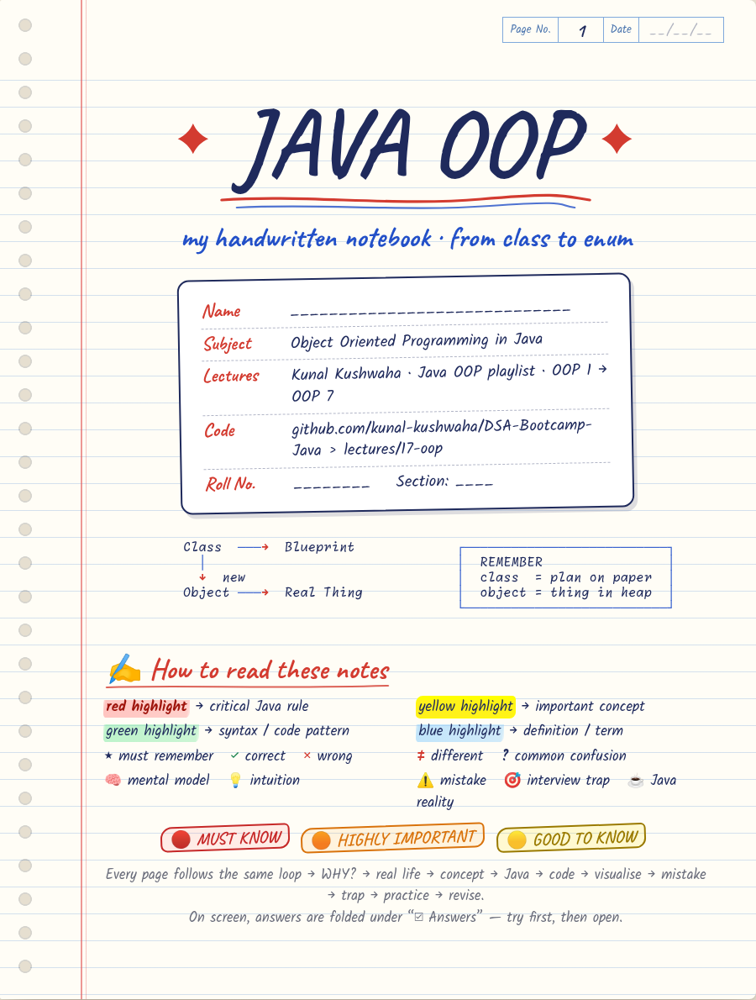
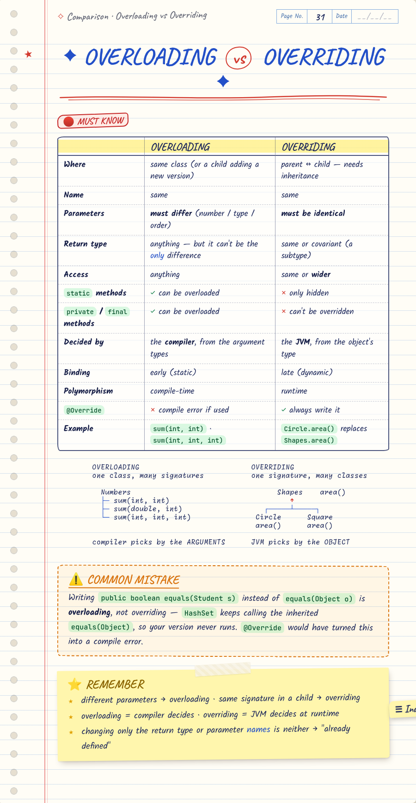
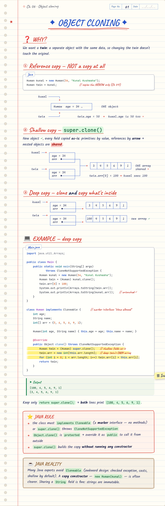

# ✦ Java OOP — Handwritten Notebook ✦

A handwritten-style notebook covering all 7 videos of Kunal Kushwaha's Java OOP playlist, with code from `DSA-Bootcamp-Java/lectures/17-oop`.

📖 **Read it:** open [`Java-OOP-Notebook.pdf`](Java-OOP-Notebook.pdf) right here on GitHub, or download [`Java-OOP-Notebook.html`](Java-OOP-Notebook.html) and open it in a browser for the interactive version.

<p>



</p>

| File | What it is |
|---|---|
| `Java-OOP-Notebook.html` | The notebook. A single self-contained file with the fonts embedded; open it in any browser. Answers are folded under "☑ Answer". |
| `Java-OOP-Notebook.pdf` | A4 print version (169 pages, all answers expanded). |
| `previews/` | Sample pages as PNG images. |
| `source/` | Markdown chapters, stylesheet and build scripts, so you can edit and rebuild. |

**Inside (81 notebook pages):** cover, index and the "story of OOP" · Ch 01–07, one per video · 13 comparison pages · 36 numbered interview traps · practice and a teacher box per chapter · an 85-question interview bank · 3 mini projects with starter code · master map · one-page cheat sheet.

## Rebuild after editing `source/chapters/*.md`

```bash
cd source
pip install markdown pygments fonttools brotli pypdf
python3 build.py --verify --pdf
```

- `--verify` compiles and runs all 68 checked Java examples and compares them with the outputs printed in the notes. It needs JDK 25, because some notes describe Java 25 behaviour.
- `--pdf` renders the PDF with headless Chromium through Playwright. Set `PW_CORE` / `CHROME` if your paths differ from the defaults in `render.js`.

Fonts (all SIL OFL): Caveat and Kalam (handwriting), JetBrains Mono (code), Monaspace Radon (hand-drawn diagrams).
